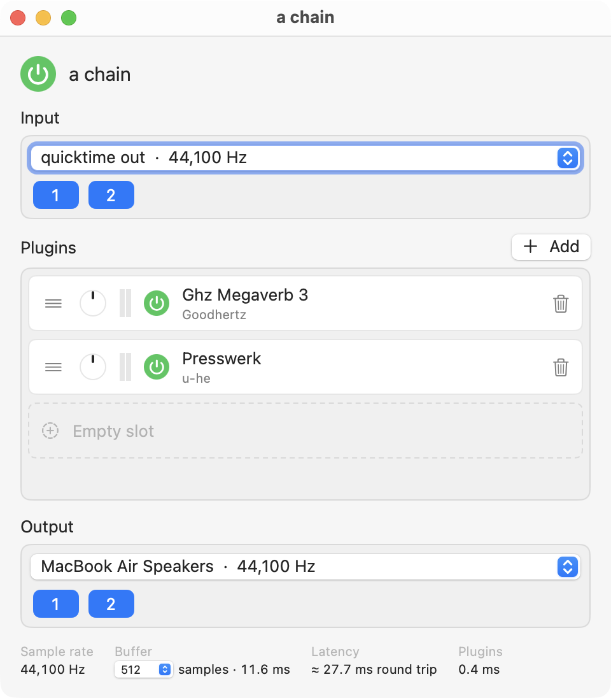

# Plainchain

A macOS app that does exactly three things, in as many windows as you like, each an independent session:

1. Pick an audio input device and its channels, or a MIDI source.
2. Run that audio through an ordered chain of Audio Unit effects you can add, remove, reorder, bypass, and open the editor for; with MIDI input, the chain starts with an instrument that the MIDI plays.
3. Pick an output device and its channels.

Sessions (devices, chain, and every plugin's state) save to `.plainchain` files: SQLite databases whose rows are Cap'n Proto messages.



## Layout

| Path | What |
|---|---|
| `app/Package.swift` | SwiftPM package; the whole app is one executable target. |
| `app/Sources/Plainchain/Engine.swift` | The realtime graph. |
| `app/Sources/Plainchain/Devices.swift` | CoreAudio HAL enumeration and aggregate-device creation. |
| `app/Sources/Plainchain/Plugins.swift` | Audio Unit discovery and parameter info. |
| `app/Sources/Plainchain/PluginInstance.swift` | One loaded Audio Unit: instantiation, state, and the parameter-change signal. |
| `app/Sources/Plainchain/Midi.swift` | CoreMIDI input: `MidiSystem` (the one client, source list, and "Plainchain" virtual destination) and `MidiInput` (each session's input port). |
| `app/Sources/Plainchain/AppState.swift` | What the windows share: device list and HAL listeners, plugin list, MIDI sources, the open-session list restored at launch, file opens. |
| `app/Sources/Plainchain/Model.swift` | One session window: session edits, plugin instances, engine restarts, autosave, session files, the close prompt. |
| `app/Sources/Plainchain/Session.swift` | Session files: SQLite container, with a small sqlite3 wrapper. |
| `app/Sources/Plainchain/Capn.swift` | Swift face of the Cap'n Proto records. |
| `app/Sources/CapnSession/` | C++ target: generated schema code plus a C API over it for Swift, and the small realtime helpers (`pc_atomic.h`, `pc_midi.h`: the MIDI event rings). |
| `schema/session.capnp` | The record schema. `tools/gen-capnp.sh` regenerates the C++ after edits. |
| `app/Sources/Plainchain/Editors.swift` | Plugin editor windows. |
| `app/Sources/Plainchain/PlainchainApp.swift` | The window group (one window per session), menu commands, app delegate. |
| `app/Sources/Plainchain/ContentView.swift` | A session window's contents. |
| `app/Sources/Plainchain/Smoke.swift` | Headless engine check (`--smoke`; with `PC_MIDI=1`, the MIDI check). |
| `app/Sources/Plainchain/HotplugTest.swift` | Headless device hot-plug and two-session check (`--hotplug-test`), run in the test VM. |
| `tools/testvm.sh` | Runs things in the Tart test VM through the testvm repository's tool (`~/projects/testvm`, github.com/jdf/testvm): `up`/`down` the guest, `push` the bundle, `run` a command, `hotplug`, `midi`. |
| `Makefile` | Builds and assembles `build/Plainchain.app`. |

## Build and run

```sh
make run        # swift build, bundle, open
make smoke      # headless: default in -> out for 2 s, then a session round trip
make hotplug-test  # headless, in the Tart test VM: unplug and replug a fake interface under a running session, then two sessions side by side
make midi-test  # headless, in the Tart test VM: a virtual MIDI source plays Apple's DLS synth into BlackHole
PC_IN="Loopback" PC_OUT="MacBook Air Speakers" make smoke PLUGINS="AUDelay AUGraphicEQ"
```

Requires Xcode (Swift 6) and Homebrew's `capnp` (`brew install capnp`) for its static library and headers; the `capnp` compiler itself is only needed to regenerate code after a schema change. Cap'n Proto is linked statically, so the bundle has no Homebrew dependency at runtime. The app must run from the bundle so macOS can ask for microphone access.

## Distributing

```sh
make dist       # sign, notarize (waits for Apple), staple, zip -> build/Plainchain.zip
```

Needs a notarytool keychain profile, created once with `xcrun notarytool store-credentials <profile> --apple-id <id> --team-id <team>`. Signing uses the identity in the `DEVELOPER_ID_APPLICATION` environment variable (set it in your shell profile); without it builds are ad-hoc signed, which runs locally but cannot be notarized. The notary profile defaults to `plainchain`; override with `make dist PROFILE=<profile>`.

## Windows

Each window is an independent session with its own input (audio device or MIDI source), chain, output, and engine, and all of them run at once: one window can take channels 3–4 of an interface out to 5–6 while another plays MIDI into an instrument out to 3–4. Windows connect only through devices; there is no bus between them. Each engine is its own HAL client (with its own private aggregate when input and output differ), and CoreAudio mixes several clients writing to the same output channels. The device list, plugin list, and MIDI sources are shared; one HAL listener serves every window and tells each when devices come and go, so a device that disappears tears down only the windows using it.

The buffer size belongs to the device, not the session: changing it in one window changes it for every window on that device, and their status bars pick it up within a second.

File ▸ New Session (⌘N) opens a new untitled window. Opening a session file (File ▸ Open Session…, Finder, `open`) brings its window forward if it is already open, loads it into the front window if that one is untitled and untouched, and otherwise opens a new window. Save and Save As act on the front session window. Closing a window that holds something unsaved (an untitled session with any plugin or non-default devices, or a titled one with edits) asks Save / Don't Save / Cancel. Quitting never asks: every open window is autosaved and comes back at the next launch, in the same order.

## How the engine works

One CoreAudio HAL output unit handles both input (bus 1) and output (bus 0). When the chosen input and output are the same device, it is used directly. When they differ, the app creates a private aggregate device of the two, with the output device as clock master and drift compensation on the input, so CoreAudio handles clock drift and differing sample rates. The aggregate is destroyed when the graph is torn down.

The app listens for HAL device-list changes. When a session device disappears, or comes back under a new object id, the graph is torn down and the app shows "Waiting for …"; when both session devices are present again the graph is rebuilt on its own. The app's own private aggregates are left out of the device list, so creating one never counts as a change.

`make hotplug-test` checks this headlessly in the Tart test VM (`tools/testvm.sh`; never on the host, where it would route the live microphone to the speakers). It fakes an audio interface with a public aggregate device under a fixed UID wrapping the guest's BlackHole device (input 1-2 to output 3-4), then unplugs it (destroys the aggregate) and replugs it (recreates it under a new object id) beneath a running session, and checks the "Waiting for …" teardown, the unattended rebuild, and that nothing restarts afterwards. It then runs two sessions on one `AppState`, as two windows would: A plays the fake interface's input through AUDelay back out, B plays a virtual MIDI source into Apple's DLS synth straight to the device the fake wraps, on output 5-6. Both must run for 2 s with no render errors; a note must move B's meter while A's input stays digital silence (and the note must not reach A's MIDI input); unplugging the fake must tear down A only, with B running on undisturbed, and the replug must bring A back. The test runs in the guest's GUI (Aqua) session, because over plain ssh TCC judges the microphone request against sshd rather than the app; the guest also needs a microphone grant for `com.plainchain.app` in its TCC database, or every HAL call hangs (BlackHole's input counts as a microphone too).

### The test VM

The guest is the shared `whatis-tests` Tart VM, whose lifecycle belongs to the testvm repository, cloned at `~/projects/testvm` (or `TESTVM_DIR`); it must be booted with `--no-audio` (that tool's `up`, which `tools/testvm.sh up` runs, does that): otherwise its "Apple Virtual Sound Device" passes straight through to the host's speakers and microphone. It must have the BlackHole 16ch loopback driver installed, and every audio test targets BlackHole by name (`PC_IN=BlackHole PC_OUT=BlackHole`, a name substring), never the default devices. BlackHole loops each output channel back into the same input channel, so the tests never write a channel they read: a session reads 1-2 and writes 3-4, and a second session writes 5-6. The nested-aggregate scenario stays best-effort: with BlackHole in both roles the private aggregate (the fake interface plus BlackHole) never reports the channel count the engine waits for ("has 16 output channels, not yet 20"), so the refusal is reported and not counted.

Effects are wired with `kAudioUnitProperty_MakeConnection`. The first effect's render callback pulls the current IO cycle's input straight from the HAL unit into the effect's own buffers, so there is no intermediate buffer and no added latency beyond the device's own.

Plugin instances (`PluginInstance`) are owned by the model, not the engine. The engine only sets their formats, wires them, and initializes them (and holds a reference until it is torn down, so a unit is never disposed under a running graph), so rebuilding the graph (device or channel change, reorder) keeps every plugin's settings. Version 2 components are instantiated synchronously on the main thread with `AudioComponentInstanceNew`, as mainstream hosts do: JUCE-based and similar plugins take the thread that creates them as their message thread, and an editor shown on the main thread after a background instantiation spins or refuses to draw (Arturia, Pianoteq). Version 3 components run out of process and keep `AVAudioUnit.instantiate`. Editor windows try the plugin's v2 Cocoa view, then a v3 plugin's `requestViewController`, then `AUGenericView`. Plugin state is `kAudioUnitProperty_ClassInfo` for v2 and `AUAudioUnit.fullState` for v3 (for a v2 unit the two are the same dictionary), stored as a binary plist inside the chain item's record.

Plugin edits are observed rather than polled: an `AUEventListener` on each v2 unit's parameters (and its `PresentPreset` and `ClassInfo` properties), or a parameter-tree observer for v3, marks the session edited when a value actually changes. Observation starts after the host has loaded the plugin's state, and notifications that repeat a known value are ignored, so opening a session or rebuilding the graph does not count as an edit. Full plugin state is read only when a file is written.

### MIDI input

When the input is a MIDI source, there is no input device: the graph runs on the output device alone (no aggregate, HAL input left off), and the chain head is an instrument (`aumu`) that takes the place of the HAL input bus as the source. It renders into a pass-through `AUConverter`, so the stage between them gives the instrument its own output trim and meter; effects follow as usual. The chain is stereo when two or more output channels are chosen, else mono. Without an instrument the graph runs silent and the app says "Add an instrument to play MIDI into". An instrument always stays at position 0.

One CoreMIDI client per process gives each session window an input port, connected to the chosen source (by `kMIDIPropertyUniqueID`) or to every source, and reconnected when the MIDI setup changes. It also publishes one virtual destination named "Plainchain" that other apps can send to; that counts as one more source under "All MIDI Sources", so its events reach every window listening to all sources (through a small lock-free hub of the windows' fanouts in `pc_midi.h`). MIDI never calls into an Audio Unit from CoreMIDI's thread. The receive blocks take MIDI 1.0 channel-voice messages (UMP type 2) and push them into fixed-size lock-free rings (`pc_midi.h`), one ring per MIDI-receiving unit: the instrument, then each music effect (`aumf`). The render thread drains a unit's ring with `MusicDeviceMIDIEvent` in the stage that pulls from that unit, just before it renders, so events land at the start of the next buffer. Changing the MIDI source reconnects the port without rebuilding the graph.

`make midi-test` checks this headlessly in the Tart test VM (`tools/testvm.sh midi`, which runs `Plainchain --smoke` with `PC_MIDI=1`): a virtual MIDI source plays Apple's DLS synth, followed by two effects, into BlackHole outputs 1-2 (nothing reads its inputs), selected by unique ID, through "All MIDI Sources", and through the virtual destination; it also reorders the effects live, round-trips a MIDI session file, and drives the app model through the empty-head hint, a source switch, and refused moves.

## Session file format

A `.plainchain` file is a SQLite database (`PRAGMA application_id` = `PLCH`, `user_version` = format version: 1, or 2 when the input is MIDI or the chain has an instrument, so audio sessions still open in older versions):

| Table | Columns | Row |
|---|---|---|
| `meta` | `key`, `value` | `saved` timestamp, `app` |
| `endpoint` | `role`, `message` | one `Endpoint` message for `input` and one for `output`; a MIDI input has a non-empty `midiSource` (a source's unique ID, or `*` for all) and `midiSourceName`, and keeps its last audio device and channels |
| `chain` | `position`, `message` | one `ChainItem` message per slot, in chain order |

Messages are flat (unpacked) Cap'n Proto, per `schema/session.capnp`, so the `capnp` CLI can decode them straight out of the database:

```sh
sqlite3 s.plainchain "SELECT quote(message) FROM chain WHERE position=0" | sed "s/^X'//;s/'$//" | xxd -r -p | capnp decode schema/session.capnp ChainItem
```

Saves write a fresh database beside the target and swap it in atomically.

Constraints:

- The chain runs at the width of the input selection: one input channel means mono through every plugin. Plugins that only accept stereo fail to initialize with "format not supported"; select two input channels.
- Changing devices, channels, or adding or removing a plugin tears down and rebuilds the graph (a brief dropout). Reordering is live: the output fades to silence over 8 ms, the stages are repointed on the render thread, and it fades back in. Bypass and trim are applied live.

The engine starts running when its window opens; the Run switch pauses it. The open windows are listed, in order, under `openSessions` in `defaults read com.plainchain.app` (a session file's path, or none for an untitled session, and an id). Each window autosaves to `~/Library/Application Support/Plainchain/Autosave-<id>.plainchain`: always for an untitled session, and for a titled one while it has unsaved edits, which come back at the next launch still marked as edited. Closing a window on purpose deletes its autosave. Versions before session windows kept one `Autosave.plainchain` and a `sessionPath` default; the first launch moves them into the list.

## License

MIT. See `LICENSE`.
